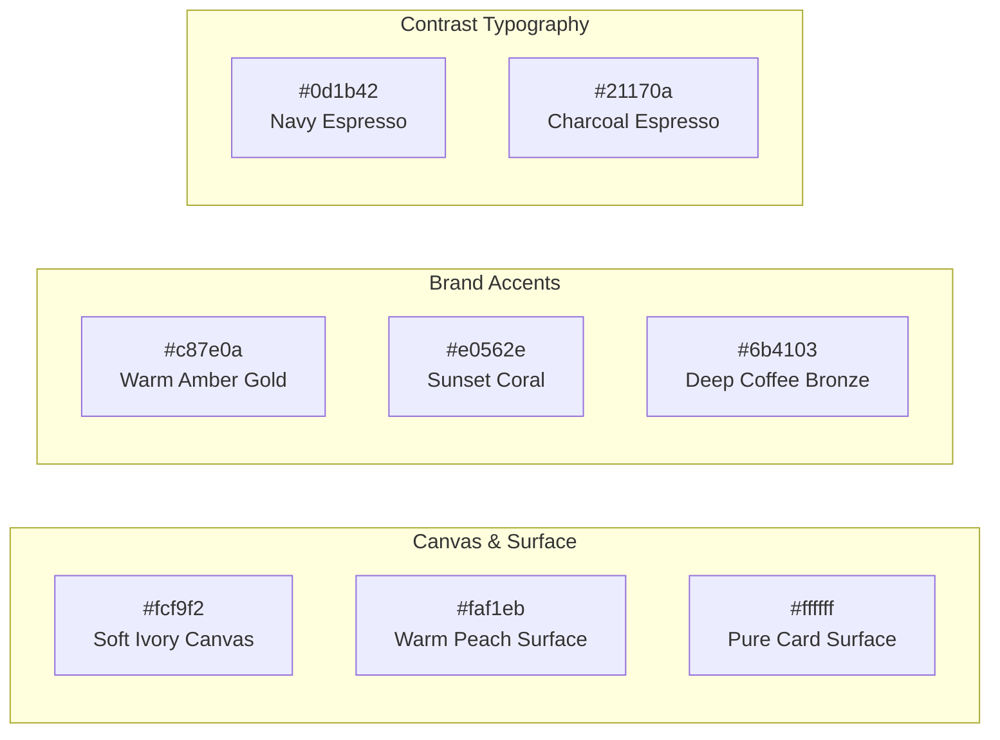
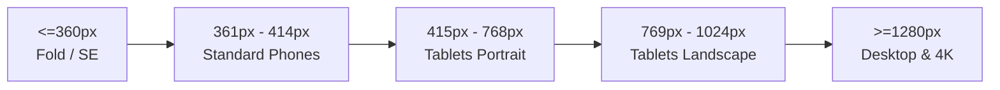

# Design Document & System Specifications — SplitSpace
**Document Version:** 2.0.0  
**Design Paradigm:** Warm Tactile Minimalism & Precision Fintech  
**Typography:** Space Grotesk (Primary/Display), Inter (Neutral Body), Fraunces (Editorial Accents)  
**Animation Engine:** Framer Motion (`motion/react`) + CSS GPU Keyframes  

---

## 1. Design Philosophy & Aesthetic Foundation

### 1.1 "Warm Tactile Minimalism"
SplitSpace breaks away from cold, sterile fintech interfaces and generic blue-dominant enterprise templates. The design language fuses:
- **Warmth & Hospitality**: Soft ivory canvases (`#fcf9f2`), honey-cream surfaces (`#faf1eb`, `#f8efe0`), and sunset terracotta amber accents (`#c87e0a`, `#e0562e`).
- **Tactile Materiality**: Physical depth achieved through multi-layered ambient shadows, subtle 1px border lines, and 3D card tilt interactions that react dynamically to pointer coordinates.
- **Fintech Precision**: Geometric tabular figure alignment (`font-feature-settings: "tnum"`), strict micro-spacing grids, and crisp contrast ratios against deep espresso navy typography (`#0d1b42`, `#21170a`).
- **Spring Physics**: Fluid, non-linear micro-interactions powered by Framer Motion springs (`stiffness: 260`, `damping: 24`) that give the application a physical, responsive weight.

---

## 2. Color Palette & Design Tokens

### 2.1 Core Palette Tokens



| Token Name | Hex Value | RGBA / Variable | Functional Role |
|---|---|---|---|
| `--bg` | `#fcf9f2` | `252, 249, 242` | Primary application canvas backdrop |
| `--surface` | `#ffffff` | `255, 255, 255` | Card surfaces, modal bodies, active tab containers |
| `--surface2` | `#faf1eb` / `#f8efe0` | `250, 241, 235` | Secondary panels, inputs, chips, hover states |
| `--surface3` | `#edd9be` / `#edd4c3` | `237, 217, 190` | Active segmented chips, modal headers, borders |
| `--primary` | `#c87e0a` | `200, 126, 10` | Primary brand accent, main CTAs, active indicators |
| `--primary-hover` | `#b06c04` | `176, 108, 4` | Hover state for primary buttons |
| `--primary-coral` | `#e0562e` | `224, 86, 46` | High-energy secondary brand accent, badges |
| `--primary-glow` | — | `rgba(200, 126, 10, 0.28)` | Focus rings, button glow shadows |
| `--primary-subtle`| — | `rgba(200, 126, 10, 0.12)` | Subtle badge backgrounds, pill highlights |
| `--secondary` | `#6b4103` | `107, 65, 3` | Deep bronze accent, secondary actions |
| `--navy` | `#0d1b42` | `13, 27, 66` | Primary high-contrast text, hero display headings |
| `--text` | `#21170a` | `33, 23, 10` | General UI body text |
| `--text2` | — | `rgba(33, 23, 10, 0.72)` | Secondary descriptive text, input labels |
| `--text3` | — | `rgba(33, 23, 10, 0.48)` | Tertiary captions, placeholders, timestamps |
| `--border` | — | `rgba(107, 65, 3, 0.09)` | Standard divider lines and card borders |
| `--border2` | — | `rgba(107, 65, 3, 0.16)` | Input borders, elevated element boundaries |
| `--border-strong` | — | `rgba(107, 65, 3, 0.26)` | High-emphasis interactive boundaries |

### 2.2 Semantic Status Palette

| State | Color Name | Hex Code | Background Tint | Usage |
|---|---|---|---|---|
| **Positive / Receivable** | Emerald Green | `#059669` | `rgba(5, 150, 105, 0.12)` | "You are owed", credit balances, verified checks |
| **Negative / Payable** | Rust Crimson | `#c2410c` / `#c73f31` | `rgba(194, 65, 12, 0.12)` | "You owe", debit balances, delete warnings |
| **Informational** | Cobalt Blue | `#3b82f6` | `rgba(59, 130, 246, 0.10)` | Multi-currency tags, audit trail badges |
| **Accent Glow** | Warm Ochre | `#d98a0d` | `rgba(217, 138, 13, 0.14)` | Important notifications, owner badges |

---

## 3. Spacing, Elevation & Corner Radii Scale

### 3.1 Spacing & Padding Scale
SplitSpace uses an 8-point geometric spacing grid with 4-point micro-increments:

| Spacing Token | Pixels | Tailwind Equiv. | Typical Application |
|---|---|---|---|
| `space-1` | `4px` | `p-1`, `gap-1` | Chip internal padding, sub-element gaps |
| `space-2` | `8px` | `p-2`, `gap-2` | Button icon gaps, badge padding, list item gaps |
| `space-3` | `12px` | `p-3`, `gap-3` | Expense row padding, input horizontal padding |
| `space-4` | `16px` | `p-4`, `gap-4` | Stat card padding, bento grid gap, panel margins |
| `space-5` | `20px` | `p-5`, `gap-5` | Hero banner vertical padding, modal inner sections |
| `space-6` | `24px` | `p-6`, `gap-6` | Bento card padding, desktop modal padding |
| `space-8` | `32px` | `p-8`, `gap-8` | Main dashboard outer margins, section spacing |
| `space-12` | `48px` | `p-12`, `gap-12` | Landing page section padding, hero top padding |

### 3.2 Corner Radii Tokens
- `--r-sm` (`10px`): Badges, tooltips, small icon buttons, preset chips.
- `--r-md` (`16px`): Input fields, primary buttons, space rows, balance cards.
- `--r-lg` (`22px`): Content panels, stat cards, expense items.
- `--r-xl` (`28px`): Main hero banner, modal dialogue windows, bento cards.

### 3.3 Elevation & Shadows

```css
--shadow-sm: 0 2px 12px rgba(107, 65, 3, 0.05);
--shadow-md: 0 8px 30px rgba(107, 65, 3, 0.09);
--shadow-lg: 0 24px 60px rgba(107, 65, 3, 0.15);
--shadow-glow: 0 0 24px var(--primary-glow);
```

---

## 4. Typography Hierarchy & Fluid Sizing

### 4.1 Typeface Families
1. **Space Grotesk** (`font-family: 'Space Grotesk', sans-serif`): Geometric sans-serif engineered for precision fintech interfaces, display banners, labels, and all currency figures. Always configured with `font-feature-settings: "tnum", "ss01"` for tabular figure vertical alignment.
2. **Inter** (`font-family: 'Inter', sans-serif`): Neutral body font utilized for dense paragraphs and multi-line descriptions.
3. **Fraunces** (`font-family: 'Fraunces', serif`): Warm optical editorial serif with soft italics, utilized strategically in Hero titles, modal headers, and key financial balance numbers to convey artisanal craftsmanship.

### 4.2 Type Scale Hierarchy

| Element | Font Family | Size Specification | Weight | Line Height | Letter Spacing |
|---|---|---|---|---|---|
| **Display 1 (Hero Title)** | Fraunces (Italic) | `clamp(32px, 8.5vw, 44px)` | 500 | `1.15` | `-0.02em` |
| **Section Headings (H2)** | Space Grotesk | `clamp(24px, 3.4vw, 36px)` | 700 | `1.20` | `-0.02em` |
| **Card & Panel Titles (H3)**| Space Grotesk | `18px - 20px` | 700 | `1.30` | `-0.015em` |
| **Primary Numbers (Stats)** | Space Grotesk (tnum) | `clamp(20px, 3.8vw, 28px)` | 700 | `1.15` | `-0.02em` |
| **Body Large** | Space Grotesk / Inter | `14.5px - 15px` | 400 / 500 | `1.60` | `0` |
| **Body Regular** | Space Grotesk / Inter | `13.5px - 14px` | 400 | `1.55` | `0` |
| **Labels & Eyebrows** | Space Grotesk | `10px - 11px` | 700 | `1.20` | `+0.08em` (UPPERCASE) |
| **Micro Captions** | Space Grotesk | `9px - 10px` | 600 | `1.20` | `+0.04em` |

---

## 5. Component Specifications & Design Patterns

### 5.1 Navigation Sidebar (`SpaceSidebar.tsx`)
- **Dimensions**: Fixed desktop width of `260px` (`--sidebar-w`). Height: `100vh`.
- **Background**: Soft vertical gradient: `linear-gradient(180deg, #faf1eb 0%, #f5e5da 45%, #edd4c3 100%)`.
- **Anatomy**:
  - **Brand Header**: 38px gradient brand dot (`var(--primary)` to `var(--secondary)`) with white brand letter and app title.
  - **New Space CTA**: Full-width high-contrast gradient button with subtle hover translateY.
  - **Space List**: Scrollable vertical stack of space rows. Active space highlighted with `#ffffff` container, subtle border, and coral emoji container. Hover state triggers a `+2px` horizontal slide.
  - **Footer Account Bar**: Avatar circle, user name, email, quick settings trigger, and keyboard shortcut overview.

### 5.2 Mobile Top Bar
- **Dimensions**: Fixed 56px height, positioned at `inset: 0 0 auto 0`.
- **Material**: Glassmorphism surface with `background: rgba(250, 241, 235, 0.94)` and `backdrop-filter: blur(18px)`.
- **Controls**: Hamburger menu trigger (left), centered brand text, and active space emoji badge.

### 5.3 Bento Grid & Feature Cards (`LandingPage.tsx`)
- **Structure**: 12-column adaptive CSS Grid (`grid-template-columns: repeat(12, 1fr); gap: 16px`).
- **Cards**:
  - *Dynamic Bill Splitting* (Span 7): Prominent calculation illustration with auto-split breakdown.
  - *1-Click Gmail & PDF* (Span 5): Dispatch visual with security check badges.
  - *Global Multi-Currency* (Span 4): Interactive currency chips (`USD $`, `EUR €`, `GBP £`, `INR ₹`).
  - *Instant Space Invites* (Span 4): 7-day token access preview.
  - *Zero-Cent Rounding Loss* (Span 4): Exact decimal balancing indicator.
- **Interactivity**: Micro-lift on hover (`y: -6, scale: 1.015`) with spring transitions.

### 5.4 3D Tilt Cards (`SpaceStats.tsx` & `tilt-card.tsx`)
- **Perspective**: 3D container with `perspective: 1500px`.
- **Physics**: Pointer position relative to card center translates into real-time $X$ and $Y$ axis rotation ($\pm 8^\circ$).
- **Active State**: Tactile depression on press: `transform: scale(0.98)` with `transition: transform 0.1s`.

### 5.5 Currency & Number Tickers (`NumberTicker.tsx`)
- **Behavior**: Uses spring motion curves to roll numerical values smoothly from their previous balance to the updated balance upon real-time sync.
- **Formatting**: Adheres strictly to space currency conventions (`en-IN` with `₹` symbol or `en-US` with `$` symbol).

### 5.6 Modal Windows & Drawers (`modals/`)
- **Container**: Max width `560px` to `680px`, radius `28px`, background `linear-gradient(160deg, #ffffff 0%, #faf1eb 60%, #f5e5da 100%)`.
- **Header**: Warm editorial title (`Fraunces`), subtext, and circular close icon button.
- **Segmented Split Pickers**: 4-way pill switch (`Equal`, `Exact`, `Percentage`, `Shares`).
- **Split Preview Box**: Highlighted terracotta container showing exact per-person calculation in real time.

---

## 6. Responsive Breakpoints & Mobile Adaptations



### 6.1 Breakpoint Grid & Component Adaptations

| Breakpoint | Target Devices | Layout Adjustments | Touch / Padding Rules |
|---|---|---|---|
| **$\le 360\text{px}$** | Galaxy Fold Cover, iPhone SE (1st gen) | • Single-column stats grid<br>• Action buttons expand to 100% width<br>• Topbar title font clamped to `20px` | Main padding: `64px 8px 32px`<br>Modal padding: `16px 12px` |
| **$361\text{px} - 414\text{px}$** | iPhone 13/14/15, Galaxy S24, Pixel 8 | • Hero actions stack vertically<br>• 2-column stats grid (`gap: 10px`)<br>• Currency lens wraps gracefully | Main padding: `68px 12px 36px`<br>Input heights: `46px` touch target |
| **$415\text{px} - 768\text{px}$** | Large phablets, iPad Mini portrait | • Sidebar translates to off-canvas slide drawer (`transform: translateX(-100%)`)<br>• Bento grid collapses to 1 column (`span 12`)<br>• Right settlement column stacks under expense ledger | Main padding: `72px 16px 44px`<br>`touch-action: manipulation` on buttons |
| **$769\text{px} - 1024\text{px}$** | iPad Air / Pro portrait, Surface tablets | • 2-column stats grid (`gap: 12px`)<br>• Main grid collapses to single column with settlements rendered side-by-side | Main padding: `28px 20px 48px`<br>Sidebar desktop view active |
| **$1025\text{px} - 1279\text{px}$** | iPad Pro landscape, small laptops | • 4-column stats grid (`gap: 10px`)<br>• Two-column layout active (`1.9fr : 1fr`) | Main padding: `28px 24px 50px`<br>Max container: 100% |
| **$\ge 1280\text{px}$** | Full HD Desktops, iMacs, 4K Displays | • Centered main container (`max-width: 1260px` to `1360px`)<br>• Hero banner with full floating 3D illustration and ambient blur orbits | Main padding: `32px 36px 60px`<br>Full perspective tilt active |
