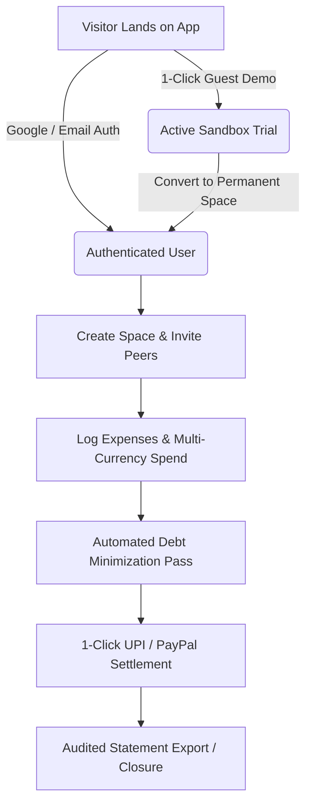

# Product Requirement Document (PRD) — SplitSpace
**Document Version:** 2.0.0  
**Status:** Production Standard  
**Target Platform:** Web (Desktop & Mobile Responsive), PWA  
**Architecture:** Serverless Edge Client (Next.js 16 App Router) + Google Cloud Firestore  

---

## 1. Executive Overview & Strategic Vision

### 1.1 Executive Summary
SplitSpace is an enterprise-grade, privacy-respecting, zero-cost group expense management and debt simplification engine. Designed as a modern, unconstrained alternative to legacy platforms (e.g., Splitwise post-monetization), SplitSpace delivers instant real-time synchronization, zero penny-rounding drift accounting, frictionless guest onboarding, dynamic multi-currency conversions, and direct banking integrations (UPI, PayPal) without subscription paywalls, third-party advertisements, or mandatory user email barriers.

### 1.2 Problem Statement
Legacy group expense tools suffer from fundamental product and technical degradations:
1. **Aggressive Monetization & Friction**: Paywalling basic capabilities (e.g., limiting non-paying users to 3 expenses per day, forced countdown timers, full-screen interstitial ads).
2. **Onboarding Obstacles**: Requiring every participant in a group to download a native app, verify phone numbers, or register an email account before an expense can be split.
3. **Floating-Point Accounting Drift**: Relying on standard IEEE-754 floating-point operations that introduce fractional penny rounding errors across odd member splits ($10.00 / 3 = $3.33 each with a missing $0.01).
4. **Sub-optimal Settlement Topologies**: Failing to collapse circular liabilities, causing participants to execute excessive, repetitive peer-to-peer bank transfers.
5. **High Server Maintenance Overhead**: Running legacy stateful monolithic backends that incur heavy server upkeep costs and introduce operational latency.

### 1.3 Strategic Value Proposition
SplitSpace resolves these deficiencies through an app-first, serverless architecture:
- **Zero-Cost Serverless Footprint**: Client-side Next.js 16 static export hosted on Firebase CDN, querying Google Cloud Firestore directly via authenticated atomic transactions. Infrastructure costs remain strictly $0.00 within standard cloud free tiers.
- **Immediate Guest Demo Mode**: Users can explore, test, and manipulate a fully functioning demo space in a single click without registration.
- **Flexible Member Modeling**: Group creators can provision members with a single name string; email addresses and user accounts are purely optional.
- **Exact Double-Entry Integer Cents Ledger**: 100% guaranteed balance reconciliation with remainder cent redistribution.
- **Greedy Debt Graph Minimizer**: Solves transitivity in circular debt graphs, reducing settlement steps from $O(N^2)$ to at most $N-1$.
- **Multi-Currency Spend Lens**: Real-time FX exchange rate conversion across 10 global currencies cached with 10-minute TTLs.
- **Instant Settlement Deep Linking**: Direct deep-links into UPI banking apps (`upi://pay`) and PayPal (`paypal.me`).

---

## 2. User Personas & Real-World Use Cases

### 2.1 Persona Matrix

| Persona | Role & Demographics | Core Pain Points | SplitSpace Solution |
|---|---|---|---|
| **Maya S.** | **International Group Traveler** • Age: 28 • Freelance Designer • Global Explorer | • Mixing currencies (EUR, USD, THB, INR) • Spotty airport/train Wi-Fi • Group members refusing to install apps | • Multi-currency Spend Lens with live FX caching • PWA offline caching with background sync • 1-click shareable invite tokens (`/?join={token}`) |
| **Rohan & Aakash** | **Urban Apartment Roommates** • Age: 24 • Software Engineers • Shared 3BHK flat | • Recurring monthly bills (Wi-Fi, Maid, Rent) • Unequal grocery consumption • Awkward reminders and slow bank transfers | • Recurring bill automation with next-due alerts • 4 split paradigms (Equal, Exact, %, Shares) • 1-click UPI settlement with mobile deep linking |
| **Sarah T.** | **Corporate Team Lead / Offsite PM** • Age: 36 • Operations Director • Corporate Hackathon Organizer | • Rigid finance compliance & receipts • Need for formal CSV/PDF statement exports • Former members leaving mid-event | • Formula-injection safe RFC 4180 CSV export • Audited corporate PDF statement generator • Equilibrium preservation when members depart |

### 2.2 Detailed Scenario Walkthroughs

#### Scenario A: International Nomad Expedition (Tokyo & Bangkok)
- **Context**: Maya coordinates a 5-person expedition across Japan and Thailand.
- **Execution**: Maya sets the space base currency to USD. When paying for a ¥45,000 dinner in Tokyo, she logs the expense in JPY. SplitSpace automatically queries open FX endpoints, records the original ¥45,000, and converts it to $295.40 USD using cached rates. When traveling through rural zones without cellular service, the PWA service worker buffers interactions and serves local ledger data instantly.

#### Scenario B: Household Rent & Recurring Utility Cycle
- **Context**: Three flatmates share an apartment in Bangalore, India.
- **Execution**: Rohan pays the broadband bill of ₹1,899 monthly. He marks the expense as "Recurring: Monthly". On the 1st of each month, SplitSpace alerts the room and offers a 1-click option to post the next cycle. When settling up, Aakash clicks "Settle Up" on his phone; SplitSpace generates a pre-filled UPI string (`upi://pay?pa=rohan@okaxis&pn=Rohan&am=633.00&cu=INR`). Clicking the link opens Google Pay directly on his phone, completing the transfer in seconds.

#### Scenario C: Corporate Offsite Financial Reconciliation
- **Context**: Sarah organizes an internal corporate hackathon with 12 engineers.
- **Execution**: Expenses are logged across catering, swag, and venue fees. At the conclusion of the event, Sarah clicks "Export Statement", generating an executive PDF statement with reference numbers (`SS-FIN-202611-XXXX`), itemized expense tables, and authorized signature lines for HR/Finance reimbursement. She also exports an RFC 4180 CSV file with sanitized delimiters and DDE formula-injection protection for spreadsheet ingestion.

---

## 3. Core Functional Requirements (FRD)

### FR-1: Space Lifecycle & Membership Engine
1. **Creation & Configuration**:
   - Spaces MUST support custom title, emoji avatar (from curated preset grid or custom input), currency selector, and optional billing period.
   - Spaces MUST maintain an array of `Member` objects containing `id`, `name`, optional `email`, `role` (`owner` | `admin` | `member`), and optional `userUid`.
2. **Frictionless Member Provisioning**:
   - The space creator MUST be able to add ad-hoc members with solely a `name` string, requiring no associated email or Firebase Auth account.
   - When an authenticated user joins a space, their verified profile (`userUid`, `email`, `avatar`) MUST automatically bind to an existing matching member or provision a new slot atomically.
3. **Invite & Deep-Link Architecture**:
   - Invite tokens MUST be generated with cryptographic uniqueness (`crypto.randomUUID()`) and stored in `/invites/{token}` with a default 7-day TTL (`expiresAt`).
   - Deep links formatted as `https://splitspace.app/?join={token}` MUST display a public metadata card and trigger auto-registration upon authentication.
   - Spaces MUST support direct URL routing via `/?space={spaceId}`.

### FR-2: Double-Entry Integer Cent Accounting Ledger
1. **Integer Arithmetic Standard**:
   - To prevent floating-point representation drift (e.g., `0.1 + 0.2 === 0.30000000000000004`), ALL balance computations MUST convert currency values to integer cents (`Math.round(amount * 100)`) before any calculation.
   - Ledger summary math MUST preserve the global equilibrium invariant:
     $$\sum_{i=1}^{M} \text{NetBalance}_i = 0$$
2. **Remainder Cent Redistribution**:
   - When splitting an amount $A$ across $K$ members where $A \pmod K \neq 0$, the base share is $B = \lfloor A / K \rfloor$, and the remainder $R = A \pmod K$ is systematically distributed by giving 1 additional cent to the first $R$ participants in deterministic index order.
   - Example: $10.00 across 3 members yields:
     - Member 0: $3.34
     - Member 1: $3.33
     - Member 2: $3.33
     - Total: $10.00 (Zero cent drift).
3. **Four Splitting Paradigms**:
   - **Equal Split**: Even division across all space members or an active selected subset.
   - **Exact Split**: Explicit amounts assigned per member; validation enforces that the sum of parts matches the total expenditure.
   - **Percentage Split**: Percentages allocated per member; validation enforces that $\sum \% = 100\%$.
   - **Custom Weight Shares**: Proportional distribution based on integer shares (e.g., 2 shares for couples, 1 share for singles).

### FR-3: Greedy Transitive Debt Minimization Algorithm
1. **Algorithmic Specification**:
   - The platform MUST eliminate redundant circular debts (e.g., A owes B $20, B owes C $20 $\rightarrow$ A pays C $20 directly).
   - Algorithm steps:
     1. Compute net balance for each member: $\text{Net}_i = \text{Paid}_i - \text{Owed}_i$.
     2. Partition participants into **Debtors** ($\text{Net} < 0$) and **Creditors** ($\text{Net} > 0$).
     3. Sort Debtors descending by debt magnitude; sort Creditors descending by credit magnitude.
     4. Iterate two pointers $d$ and $c$, computing $\text{Settle} = \min(\text{Debt}_d, \text{Credit}_c)$.
     5. Generate settlement instruction: $D_d \xrightarrow{\text{Settle}} C_c$.
     6. Decrement balances; advance pointer when balance reaches zero.
2. **Graph Complexity**:
   - Reduces transaction count from $O(N^2)$ worst-case to at most $N - 1$ transactions for $N$ members.
3. **Departed Member Equilibrium**:
   - If a member is deleted or departs, their historical transaction records MUST be preserved, ensuring remaining member balances remain mathematically sound without corrupting historical space totals.

### FR-4: Multi-Currency FX Engine & Spend Lens
1. **Live Exchange Rates**:
   - Integrates with real-time FX rate endpoints (`https://open.er-api.com/v6/latest/{BASE}`).
   - Exchange rates MUST be cached in browser `localStorage` and memory with a 10-minute TTL (`600,000ms`).
   - If network requests fail, the client MUST fall back gracefully to hardcoded benchmark rates.
2. **Supported Currencies**:
   - Default tier: INR (₹), USD ($), EUR (€), GBP (£), AED (د.إ), SGD (S$), JPY (¥), AUD (A$), CAD (C$), THB (฿).
3. **Spend Lens Overlay**:
   - Spaces maintain an immutable `space.currency`.
   - The user interface MUST provide an on-the-fly "Spend Lens" dropdown allowing any participant to preview their entire group ledger, member balances, and total spend converted into their native currency without mutating the underlying space base currency.

### FR-5: Instant Peer-to-Peer Settlement (UPI & PayPal)
1. **UPI Mobile Banking Integration**:
   - Generates standard UPI universal links:
     `upi://pay?pa={UPI_ID}&pn={NAME}&am={AMOUNT}&cu=INR`
   - On mobile devices, clicking the link triggers native Android/iOS intent pickers for Google Pay, PhonePe, Paytm, and BHIM.
2. **PayPal Integration**:
   - Generates international transfer links:
     `https://paypal.me/{USERNAME}/{AMOUNT}`
3. **Settlement Logging**:
   - Records settle records in `/spaces/{spaceId}/settlements/{settlementId}`.
   - Recording a settlement MUST immediately update debtor and creditor balances in real time via atomic batch writes.

### FR-6: Audited Export & Dispatch Pipeline
1. **RFC 4180 CSV Export**:
   - Fields: `Date`, `Category`, `Description`, `Paid By`, `Amount`, `Currency`, `Original Amount`, `Original Currency`, `Exchange Rate`, `Notes`.
   - **Formula Injection / DDE Sanitization**: Any string cell beginning with `=`, `+`, `-`, `@`, `\t`, or `\r` MUST be prefixed with an apostrophe `'` and wrapped in escaped quotation marks.
2. **Executive Financial PDF Generation**:
   - Client-side printable HTML/PDF generator featuring corporate styling, reference codes (`SS-FIN-YYYYMM-XXXX`), member balance matrices, itemized transaction audit trails, and authorized sign-off lines.
3. **1-Click Web & Native Mail Composer**:
   - Formats pre-composed Markdown and plain text financial summaries.
   - Provides direct links to launch Gmail Web (`https://mail.google.com/mail/?view=cm...`) or native desktop/mobile mail clients (`mailto:`).

### FR-7: Real-Time Multi-Client State Sync & Activity Changelog
1. **Firestore Subscriptions**:
   - The client MUST subscribe to real-time `onSnapshot` listeners on:
     - Space document metadata: `/spaces/{spaceId}`
     - Expense collection: `/spaces/{spaceId}/expenses`
     - Settlement collection: `/spaces/{spaceId}/settlements`
     - Activity collection: `/spaces/{spaceId}/activity`
   - Data changes made by one participant MUST reflect on all other connected clients in under 1 second without full page reloads.
2. **Live Activity Changelog**:
   - Itemized logging of `expense_created`, `expense_updated`, `expense_deleted`, `settlement_created`, `member_joined`.
   - Displayed in a chronological modal drawer with search and filter capabilities.

### FR-8: Progressive Web Application (PWA) & Offline Caching
1. **Service Worker (`sw.js`)**:
   - Precaches application shell (`/`, `/manifest.json`, `/icon.svg`).
   - Strategy: Stale-While-Revalidate for static assets, scripts, stylesheets, and icons.
   - Strategy: Network-First with cached fallback for API and Firebase queries.
2. **App Manifest**:
   - Standard `manifest.json` with standalone display mode, brand orientation, amber theme color (`#c87e0a`), and responsive icons (192px, 512px).

---

## 4. Non-Functional Requirements (NFR)

### NFR-1: Performance & Web Vitals
- **Largest Contentful Paint (LCP)**: $< 1.0\text{ s}$ on standard broadband; $< 1.8\text{ s}$ on 4G mobile.
- **Interaction to Next Paint (INP)**: $< 50\text{ ms}$ across all interactive buttons, modal triggers, and inputs.
- **Cumulative Layout Shift (CLS)**: $< 0.02$.
- **Bundle Architecture**: Static export (`output: 'export'`) with Next.js Turbopack, tree-shaken icons, and code-split modal drawers.

### NFR-2: Zero Penny-Rounding Drift & Audit Integrity
- **Mathematical Invariant**: Balance reconciliation tests in `scripts/test-engine.mjs` MUST achieve 100% pass rate.
- **Immutability**: Expense split records must be stored with explicit user allocations to preserve historical reproducibility even if group membership changes later.

### NFR-3: Security, Isolation & Tenant Protection
- **Firestore Security Rules**:
  - Unauthenticated reads and writes are blocked.
  - Access to `/spaces/{space_id}/*` strictly restricted to verified members whose UID appears in `resource.data.memberUids`.
  - Base space fields (`creator_id`, `created_at`) cannot be tampered with.
  - Only the space owner (`role == 'owner'`) can delete the space.
- **Input Sanitization**: All user strings rendered into the DOM must be sanitized to prevent Cross-Site Scripting (XSS).

### NFR-4: Accessibility (a11y) & Usability
- **WCAG Compliance**: WCAG 2.1 Level AA conformance across contrast ratios (minimum 4.5:1 for body copy, 3:1 for large display headers).
- **Keyboard Navigation**:
  - Fully accessible focus rings (`outline: 2px solid var(--primary)`).
  - Global hotkeys:
    - `E`: Open New Expense Modal
    - `N`: Create New Space Modal
    - `I`: Open Invite Modal
    - `S`: Record Settlement Modal
    - `X`: Open Export & Share Modal
    - `[`: Toggle Navigation Sidebar
- **Screen Reader Support**: Semantic HTML (`<aside>`, `<main>`, `<header>`, `<section>`), ARIA labels on all icon buttons (`aria-label`, `aria-expanded`).

### NFR-5: Scalability & Operational Cost
- **Architecture**: Serverless static frontend on Firebase Hosting CDN + Firebase Cloud Firestore + Firebase Authentication.
- **Operating Cost**: $0.00 / month under typical usage (up to 50,000 daily Firestore reads, 20,000 daily writes, 10GB hosting bandwidth free).

---

## 5. Success Metrics & Key Performance Indicators (KPIs)

### 5.1 Primary Key Performance Indicators (KPIs)

| Metric | Target Objective | Measurement Mechanism |
|---|---|---|
| **Settlement Velocity** | $> 80\%$ of outstanding debts cleared within 14 days | Time elapsed between debt creation and settlement registration in Firestore |
| **Guest-to-User Conversion** | $> 35\%$ demo users create permanent accounts | Client analytics tracking transition from Demo mode to authenticated session |
| **Ledger Math Reliability** | 100.000% zero-drift reconciliation | Continuous integration test suite (`scripts/test-engine.mjs`) & client checksums |
| **Real-Time Sync Latency** | $< 500\text{ ms}$ propagation time across distributed clients | Firestore snapshot event timestamps across multi-tab instances |
| **Session Crash-Free Rate** | $> 99.95\%$ crash-free sessions | Firebase Crashlytics & browser unhandled rejection monitors |
| **Export Utilization** | $> 25\%$ of spaces utilize CSV or PDF export | Export modal action tracking (CSV download, PDF print, Gmail trigger) |
